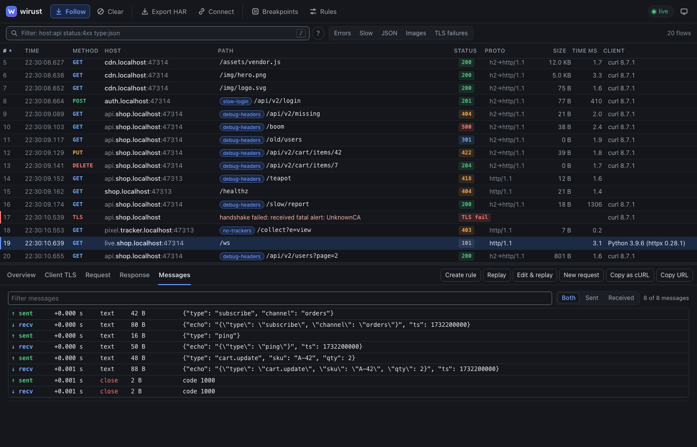

# wirust

A free HTTPS debugging proxy in one binary, with a web UI and the TLS fingerprint of every
client.

[](https://github.com/dec0iiyy/wirust/actions/workflows/ci.yml)
[](https://github.com/dec0iiyy/wirust/releases)
[](LICENSE)

wirust sits between an app and its servers and shows every request and response. It
decrypts HTTPS with a certificate authority it creates on your machine, and has a web UI
with search, rules (block, mock, map, rewrite, throttle), breakpoints that let you edit a
request before it goes out, replay, HAR import and export, WebSocket messages and a QR-code
setup for phones. What sets it apart: for each client it shows how its TLS handshake looks
(JA4, JA3 and the name of the known client it matches, such as `curl 8.7.1`), even for hosts
it relays without decrypting. That tells you which TLS stack an app really uses, whatever its
User-Agent says. It is free software (GPL-3.0-only), one binary, no account, no
telemetry.

Status: 0.3.0. Tried on an Android emulator, not on real phones yet; see [Status](#status).


<details>
<summary>More screenshots: rules panel, WebSocket messages</summary>




</details>

## Quick start

**Install.** Linux (x86_64, aarch64) and macOS (arm64, x86_64):

```sh
curl -fsSL https://github.com/dec0iiyy/wirust/releases/latest/download/install.sh | sh
```

The script checks the download against `SHA256SUMS` (and its build attestation when `gh`
is installed) and installs into `/usr/local/bin` (with `sudo` when that directory is not
writable, or `$HOME/.local/bin` when there is no `sudo`), or `--prefix DIR`. Or download a binary
from [Releases](https://github.com/dec0iiyy/wirust/releases): `wirust-linux-x86_64`,
`wirust-linux-aarch64`, `wirust-macos-arm64`, `wirust-macos-x86_64`,
`wirust-windows-x86_64.exe`. From source: `cargo build --release` (Rust 1.88+, a C compiler).

Windows (x86_64), with [Scoop](https://scoop.sh):

```powershell
scoop install https://raw.githubusercontent.com/dec0iiyy/wirust/main/packaging/scoop/wirust.json
```

winget: the manifest is prepared in [packaging/winget](packaging/winget) but is not yet in the
winget repository, so `winget install` does not find wirust yet. The Windows binary is not
code-signed, so SmartScreen may warn on first start: choose "More info", then "Run anyway".
[docs/install.md](docs/install.md) shows how to check the SHA-256 and the build attestation
(`gh attestation verify`) first.

**Run.**

```sh
wirust --ui 127.0.0.1:8081       # proxy on 127.0.0.1:8080, web UI on 8081
```

Open the private link it prints (`http://127.0.0.1:8081/#token=...`).

**Trust the CA.** It is created on first run (ECDSA P-256, 10 years) in the platform config
directory.

```sh
wirust ca path           # where the certificate is
wirust ca show           # the certificate in PEM
wirust ca install-help   # how to trust it on macOS, Linux and Windows
wirust ca install        # trust it for your user only (asks first); ca uninstall removes it
```

**Send traffic through it.**

```sh
curl -x http://127.0.0.1:8080 --cacert "$(wirust ca path)" https://example.com/
export HTTPS_PROXY=http://127.0.0.1:8080 HTTP_PROXY=http://127.0.0.1:8080
```

Browsers: run `wirust --system-proxy` to point the system proxy (macOS, Windows, GNOME) at
wirust while it runs and restore the old settings on exit, or set the HTTP and HTTPS proxy to
`127.0.0.1:8080` by hand. See [docs/desktop.md](docs/desktop.md).

In the terminal it prints one line per exchange, with or without `--ui` (`--json` for JSON
Lines):

```
13:31:06 GET    https://example.com/  200  OK  h2  289 ms  577 B  curl 8.7.1 (ja4 t13d4907h2_0d8feac7bc37_7395dae3b2f3)
13:31:07 TLS-FAIL example.com via example.com:443  received fatal alert: UnknownCA  (ja4 t13d4907h2_..., curl 8.7.1)  hint: the client does not trust the CA or pins certificates; to relay it undecrypted: --passthrough example.com
```

When a client keeps rejecting the CA, only its first `TLS-FAIL` per host and error is printed
in full; the repeats within 30 seconds become one line such as
`13:31:09 TLS-FAIL example.com (x4 more in the last 30 s)  received fatal alert: UnknownCA`.
The UI, the session file and `--json` still have every failure.

## Connect a phone

```sh
wirust connect               # Wi-Fi: listens on the LAN address, prints a QR code of the setup page
wirust android setup         # USB or emulator: adb reverse, sets the device proxy, copies the CA
wirust --android-cleanup     # then run the proxy; on exit it clears the device proxy
```

`connect` asks in the terminal before each new device may use the proxy. The setup page
(also at `http://wirust.test/` through the proxy) offers the CA as `.crt`, `.pem` and an iOS
profile. Limits, from the platforms' documentation:

- Android trusts a user-installed CA only in apps that target API 23 or lower, in browsers
  such as Chrome, and in debug builds that opt in with `debug-overrides`.
- iOS needs full trust turned on by hand for the CA; the profile is unsigned.
- Apps that pin certificates fail the handshake (`TLS-FAIL`); apps that ignore the system
  proxy (Flutter's `dart:io`, raw sockets) and HTTP/3 never reach it.
- None of this has been tried on a real phone or simulator yet. See [docs/mobile.md](docs/mobile.md).
- Experimental, not in release builds: a WireGuard capture mode (cargo feature `wireguard`)
  catches the TCP traffic of apps that ignore the proxy; see [docs/wireguard.md](docs/wireguard.md).

## Features

| Feature | Notes |
|---|---|
| HTTPS interception | HTTP/1.1 and HTTP/2 through CONNECT; plain `http://` too; server certificates checked against the Mozilla roots |
| Client TLS fingerprint | JA4, JA3 hash, TLS version, SNI, ALPN and the matched known client; the JA4 also for failed handshakes and passthrough tunnels |
| Web UI | live flow list, detail tabs, keyboard navigation, copy as cURL, Python, fetch, OkHttp, URLSession, HTTPie or PowerShell; [docs/ui.md](docs/ui.md) |
| Search | `host:` `method:` `status:5xx` `type:json` and more, in the UI, `view` and `export`; [docs/interchange.md](docs/interchange.md) |
| Rules | block, status, map local, map remote, header and body rewrite (regex, JSON path), delay, throttle; TOML file reloaded on change, editable in the UI; [docs/rules.md](docs/rules.md) |
| Scripting | sandboxed [Rhai](https://rhai.rs) scripts with `on_request` / `on_response` hooks (`--script`): headers, decoded bodies, mock answers, block, delay, flow flags; reloaded on change; [docs/scripting.md](docs/scripting.md) |
| Breakpoints | pause matching requests or responses in the UI; see and edit method, URL, status, headers and text body, then resume or abort |
| Replay and compose | send a captured request again, changed or not (UI, CLI, API), or compose a new one (UI, API); [docs/replay.md](docs/replay.md) |
| Sessions and HAR | append flows to a JSON Lines session file; export HAR 1.2 from the UI or CLI, import HAR from browser dev tools |
| WebSocket | text, binary and control messages of HTTP/1.1 WebSockets, with a Messages tab; [docs/websocket.md](docs/websocket.md) |
| gRPC, protobuf | decoding of gRPC, gRPC-Web and protobuf messages, schema-less or with field names from `.proto` files (`--proto`, compiled in-process, reloaded on change), compressed messages inflated, `grpc-status` from trailers, a gRPC tab; [docs/grpc.md](docs/grpc.md) |
| TLS passthrough | relay chosen hosts undecrypted (`--passthrough`, `--decrypt-only`); [docs/passthrough.md](docs/passthrough.md) |
| Upstream proxy | chain to an HTTP (CONNECT) or SOCKS5 proxy with a bypass list (`--upstream-proxy`, `--upstream-bypass`); [docs/upstream-proxy.md](docs/upstream-proxy.md) |
| Phones | QR-code setup with per-device approval, adb setup for Android; [docs/mobile.md](docs/mobile.md) |

## Compared with

Facts from each project's official site, checked in November 2026. A blank cell means the
official pages do not say.

| | wirust | Proxyman | Charles | mitmproxy |
|---|---|---|---|---|
| Price, licence | free, GPL-3.0-only | paid (free trial), closed source | paid (30-day trial), closed source | free, open source |
| Interface | web UI and CLI | native macOS app; Windows and Linux apps | desktop app (Windows, macOS, Linux) | terminal UI, CLI, web UI |
| Rules, map local and remote | yes | yes (paid tiers) | yes | yes |
| Breakpoints | yes | yes (paid tiers) | yes | yes |
| WebSocket | yes (HTTP/1.1) | yes | yes | yes |
| Scripting | yes (Rhai, sandboxed) | JavaScript | | Python |
| gRPC, protobuf views | yes (schema-less, or with `.proto` files) | yes (paid tiers) | protobuf viewer | yes |
| HTTP/3 | no | | | yes |
| Sets the system proxy | yes (macOS, Windows, GNOME; not yet tried on a real system) | | | |
| Client JA4, JA3 | yes | | | |

Not in wirust yet: a native app, HTTP/3. See
[docs/roadmap.md](docs/roadmap.md).

## Security

- The proxy listens on 127.0.0.1. Any other address needs `--allow-remote`: then anyone who
  can reach the port can use it, so wirust warns.
- The web UI and API are off unless you pass `--ui`. They need the random token in the
  printed link, accept only their own `Host` and `Origin` (no DNS rebinding, no cross-site
  requests), and the proxy refuses to forward to them.
- `wirust connect` listens on the LAN only while it runs and lets a device in only after you
  approve its IP address.
- The CA key (`ca-key.pem`, mode 0600 on Unix) can sign a certificate for any site. Keep the
  config directory private and remove the CA from your trust stores when you stop using
  wirust.
- Flows in memory, session files (mode 0600) and HAR exports contain the traffic's
  passwords, cookies and tokens.
- `--upstream-insecure` turns off server certificate checks and warns on every start.

Report vulnerabilities privately: [SECURITY.md](SECURITY.md).

## Options

| Option | Default | Meaning |
|---|---|---|
| `--listen ADDR` | `127.0.0.1:8080` | proxy address |
| `--ui ADDR` | off | serve the web UI and API, such as `127.0.0.1:8081` |
| `--json` | | one JSON object per line instead of text |
| `--body-limit BYTES` | `1048576` | body bytes kept per request and response |
| `--max-flows N` | `5000` | flows kept in memory for the UI and API |
| `--pause-timeout SECS` | `300` | how long a breakpoint waits before the exchange goes on |
| `--rules FILE` | | TOML rules, reloaded when the file changes |
| `--block-host HOST` | | answer HOST and its subdomains with 403 (repeatable) |
| `--add-header 'N: V'`, `--remove-header NAME` | | change every request sent to servers (repeatable) |
| `--passthrough PATTERN`, `--decrypt-only PATTERN` | | relay matching hosts undecrypted, or decrypt only those (repeatable) |
| `--session FILE` | | append every finished flow as JSON Lines |
| `--ws-body-limit BYTES`, `--ws-max-messages N` | `1048576`, `1000` | WebSocket bytes kept per message, messages per connection |
| `--ws-log` | | print one line per WebSocket message |
| `--ws-strip-compression` | | remove the client's WebSocket extension offer (by default `permessage-deflate` is decompressed for the record) |
| `--config-dir DIR` | platform config dir | where the CA is kept |
| `--allow-remote` | | allow a non-loopback `--listen` address (dangerous) |
| `--upstream-insecure` | | do not verify server certificates (dangerous) |
| `--upstream-proxy URL` | | reach servers through an `http://`, `socks5://` or `socks5h://` proxy, optional `USER:PASS@` |
| `--upstream-bypass LIST` | | hosts, `*.domains`, IPs and CIDRs that skip the upstream proxy (repeatable) |
| `--android-cleanup` | | on exit, clear the adb device's proxy |

Commands: `connect`, `android setup|reset`, `ca path|show|install-help`,
`ca install|uninstall|status`, `system-proxy on|off|status`, `export --har`, `import --har`,
`view --session`, `replay --session --id N`, and the experimental `wireguard` (only in builds
with the `wireguard` feature). `wirust --help` lists every
option; `wirust COMMAND --help` (such as `wirust ca --help`) shows one command's options.

## Documentation

[docs/README.md](docs/README.md) lists every document: install, desktop setup, the UI, rules,
scripting, HAR and search, replay, passthrough, upstream proxies, WebSocket, gRPC, phones,
WireGuard capture, architecture, design, roadmap and releasing.
[CONTRIBUTING.md](CONTRIBUTING.md) covers building, testing and where code goes.

## Status

Version 0.3.0. 302 automated tests (unit and integration, offline, in-process servers and
clients on loopback) run in CI on Linux, macOS and Windows, plus a check against Rust 1.88.
They cover HTTP/1.1 and HTTP/2 interception, the flow record and fingerprints, failed
handshakes, every control-plane security check, rules and breakpoints, scripts and their
sandbox, replay, passthrough, WebSocket capture (including `permessage-deflate` and injected
messages), gRPC and protobuf decoding with and without `.proto` schemas, `Content-Encoding`
decoding, the code generators, upstream proxies, the system-proxy and trust-store commands
(with a fake command runner), HAR, pairing and the UI assets. Checked by hand: curl through
the proxy, the web UI in headless Chrome (dark and light, down to 760 px wide), and Chrome on
an Android 16 emulator over `adb` (setup, installing the CA, decrypted HTTPS, reset on exit).
Not tried yet: real phones, anything on iOS, `system-proxy` and `ca install` on the real
operating systems, the experimental WireGuard mode outside its in-process test, Windows
outside CI.

## Licence

GPL-3.0-only; see [LICENSE](LICENSE), [NOTICE](NOTICE) and
[THIRD-PARTY-LICENSES.md](THIRD-PARTY-LICENSES.md). The TLS fingerprints come from the
`fingerprint` crate of [mirrust](https://github.com/dec0iiyy/mirrust).
