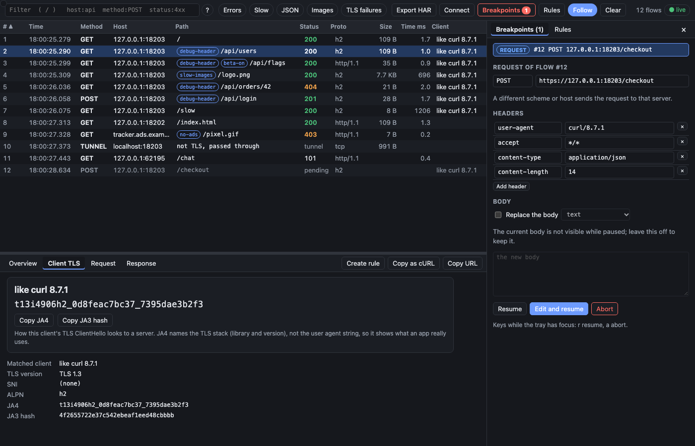

# wirust

A free HTTPS debugging proxy in one binary. See every request, change traffic on the fly,
and find out which TLS stack each client really uses.

[](https://github.com/dec0iiyy/wirust/actions/workflows/ci.yml)
[](https://github.com/dec0iiyy/wirust/releases)
[](LICENSE)



<details>
<summary>More screenshots: rules panel, WebSocket messages</summary>


</details>

## Why wirust

- **It shows who is calling.** For every request: the client's JA4 and JA3, and the known
  client they match (`curl 8.7.1`), even for hosts relayed without decrypting. That tells you
  which TLS stack an app really uses, whatever its User-Agent says. Proxyman, Charles and
  mitmproxy do not document this.
- **Free, one binary, no strings.** GPL-3.0, no account, no telemetry. Rules, breakpoints,
  scripts, replay, HAR and gRPC views come with it, without paid tiers.
- **It changes traffic.** Block, mock, map, rewrite, throttle, pause and edit a request by
  hand, or write a small script.
- **It works with phones.** Scan a QR code, or run one command for an Android device or
  emulator over USB.
- **AI agents can read it.** `wirust mcp` lets Claude Code, Cursor and others list and search
  captured traffic, with secrets redacted.

Status: 0.4.0. Tried on an Android emulator, not on real phones yet; see [Status](#status).

## Install

Linux (x86_64, aarch64) and macOS (arm64, x86_64):

```sh
curl -fsSL https://github.com/dec0iiyy/wirust/releases/latest/download/install.sh | sh
```

The script checks the download against `SHA256SUMS` (and its build attestation when `gh` is
installed). Or take a binary from [Releases](https://github.com/dec0iiyy/wirust/releases), or
build it: `cargo build --release` (Rust 1.88+, a C compiler).

Windows, with [Scoop](https://scoop.sh):

```powershell
scoop install https://raw.githubusercontent.com/dec0iiyy/wirust/main/packaging/scoop/wirust.json
```

The Windows binary is not code-signed, so SmartScreen may warn on first start: choose "More
info", then "Run anyway". A winget manifest is prepared in [packaging/winget](packaging/winget)
but is not in the winget repository yet. Checking hashes and attestations:
[docs/install.md](docs/install.md).

## Quick start

```sh
wirust --ui 127.0.0.1:8081     # proxy on 127.0.0.1:8080, web UI on 8081: open the link it prints
wirust ca install              # macOS, Windows: trust its certificate for your user only (asks first); Linux: prints the commands
curl -x http://127.0.0.1:8080 --cacert "$(wirust ca path)" https://example.com/
```

For browsers, `wirust --system-proxy` points the system proxy at wirust while it runs and
puts the old settings back on exit (macOS, Windows, GNOME); or set the HTTP and HTTPS proxy
to `127.0.0.1:8080` by hand. More in [docs/desktop.md](docs/desktop.md). All options and
commands: [docs/options.md](docs/options.md).

## What it does

**Capture**
- HTTP/1.1 and HTTP/2 through CONNECT, and plain `http://`. Server certificates are checked
  against the Mozilla roots.
- TLS passthrough for chosen hosts (`--passthrough`, `--decrypt-only`), chaining to an HTTP or
  SOCKS5 proxy (`--upstream-proxy`), and the system proxy set and restored for you.

**Inspect**
- A live flow list with search (`host:` `method:` `status:5xx` `type:json` `ws:`), detail tabs
  with the client's TLS fingerprint, headers, timing and bodies. Gzip, deflate, Brotli and
  zstd bodies are decoded; JSON, images and binary data have viewers.
- Dark and light themes, keyboard navigation, a layout that works down to 760 px.
- WebSocket messages, including compressed ones, and sending your own into a live connection.
- gRPC, gRPC-Web and protobuf, with field names when you pass `.proto` files.

**Change traffic**
- Rules in a TOML file, reloaded on change and editable in the UI: block, status, map local,
  map remote, rewrite headers and bodies, delay, throttle.
- Breakpoints: pause a request or response, edit method, URL, status, headers and text body,
  then resume or abort.
- Scripts: sandboxed [Rhai](https://rhai.rs) with `on_request` and `on_response` hooks.

**Replay and share**
- Replay a captured request as it was or changed, or compose a new one.
- Copy as cURL, Python, fetch, OkHttp, URLSession, HTTPie or PowerShell.
- Export HAR 1.2, import HAR from browser dev tools, keep sessions as JSON Lines.

**Devices and agents**
- `wirust connect` prints a QR code of a setup page and asks before each phone may use the
  proxy; `wirust android setup` does the same over USB or for an emulator.
- `wirust mcp`: a Model Context Protocol server for AI agents. Read-only by default, secrets
  redacted, captured traffic marked as untrusted data.
- A local HTTP API behind the same token as the UI.

Guides for each: [docs/README.md](docs/README.md).

## Connect a phone

```sh
wirust connect               # Wi-Fi: listens on the LAN address, prints a QR code of the setup page
wirust android setup         # USB or emulator: adb reverse, sets the device proxy, copies the CA
wirust --android-cleanup     # then run the proxy; on exit it clears the device proxy
```

The setup page offers the CA as `.crt`, `.pem` and an iOS profile. Limits, from the platforms'
documentation:

- Android trusts a user-installed CA only in browsers such as Chrome, in apps that target API
  23 or lower, and in debug builds that opt in with `debug-overrides`.
- iOS needs full trust turned on by hand for the CA; the profile is unsigned.
- Apps that pin certificates fail the handshake (`TLS-FAIL`); apps that ignore the system
  proxy (Flutter's `dart:io`, raw sockets) and HTTP/3 never reach the proxy.
- Tried on an Android emulator only; not on a real phone and not on iOS. Details and the
  experimental WireGuard mode for apps that ignore the proxy: [docs/mobile.md](docs/mobile.md),
  [docs/wireguard.md](docs/wireguard.md).

## Compared with

Facts from each project's official site, checked in November 2026. A blank cell means the
official pages do not say.

| | wirust | Proxyman | Charles | mitmproxy |
|---|---|---|---|---|
| Price, licence | free, GPL-3.0-only | paid (free trial), closed source | paid (30-day trial), closed source | free, open source |
| Interface | web UI and CLI | native macOS app; Windows and Linux apps | desktop app (Windows, macOS, Linux) | terminal UI, CLI, web UI |
| Rules, map local and remote | yes | yes (paid tiers) | yes | yes |
| Breakpoints | yes | yes (paid tiers) | yes | yes |
| WebSocket | yes (HTTP/1.1) | yes | yes | yes |
| Scripting | yes (Rhai, sandboxed) | JavaScript | | Python |
| gRPC, protobuf views | yes (schema-less, or with `.proto` files) | yes (paid tiers) | protobuf viewer | yes |
| HTTP/3 | no | | | yes |
| Sets the system proxy | yes (macOS, tried by hand; Windows and GNOME not yet tried on a real system) | | | |
| Client JA4, JA3 | yes | | | |

Not in wirust yet: a native app, HTTP/3. See [docs/roadmap.md](docs/roadmap.md).

## Security

- The proxy listens on 127.0.0.1. Any other address needs `--allow-remote`: then anyone who
  can reach the port can use it, so wirust warns.
- The web UI and API are off unless you pass `--ui`. They need the random token in the
  printed link, accept only their own `Host` and `Origin` (no DNS rebinding, no cross-site
  requests), and the proxy refuses to forward to them.
- `wirust connect` listens on the LAN only while it runs and lets a device in only after you
  approve its IP address.
- The CA key (`ca-key.pem`, mode 0600 on Unix) can sign a certificate for any site. Keep the
  config directory private and remove the CA from your trust stores when you stop using wirust.
- Flows in memory, session files (mode 0600) and HAR exports contain the traffic's passwords,
  cookies and tokens. `--upstream-insecure` turns off server certificate checks and warns on
  every start.

Report vulnerabilities privately: [SECURITY.md](SECURITY.md).

## Documentation

[docs/README.md](docs/README.md) lists every document: install, options, desktop setup, the
UI, rules, scripting, HAR and search, replay, passthrough, upstream proxies, WebSocket, gRPC,
the MCP server, phones, WireGuard capture, architecture, design, roadmap and releasing.
[CONTRIBUTING.md](CONTRIBUTING.md) covers building, testing and where code goes.

## Status

Version 0.4.0. 321 automated tests (unit and integration, offline, on loopback) run in CI on
Linux, macOS and Windows, plus a build check against Rust 1.88.

Checked by hand:
- curl through the proxy.
- The web UI in headless Chrome, dark and light, 760 to 1400 px wide: `scripts/ui-e2e.mjs`
  makes 174 checks of clicks, keys, dialogs and layout (run by hand, not in CI).
- Chrome on an Android 16 emulator over `adb`: setup, installing the CA, decrypted HTTPS,
  reset on exit.
- `system-proxy` on macOS: on, off, Ctrl-C and a killed process each restored the old settings.

Not tried yet: real phones, anything on iOS, `system-proxy` on Windows and GNOME, `ca install`
on any real system, the experimental WireGuard mode outside its in-process test, Windows
outside CI.

## Licence

GPL-3.0-only; see [LICENSE](LICENSE), [NOTICE](NOTICE) and
[THIRD-PARTY-LICENSES.md](THIRD-PARTY-LICENSES.md). The TLS fingerprints come from the
`fingerprint` crate of [mirrust](https://github.com/dec0iiyy/mirrust).
