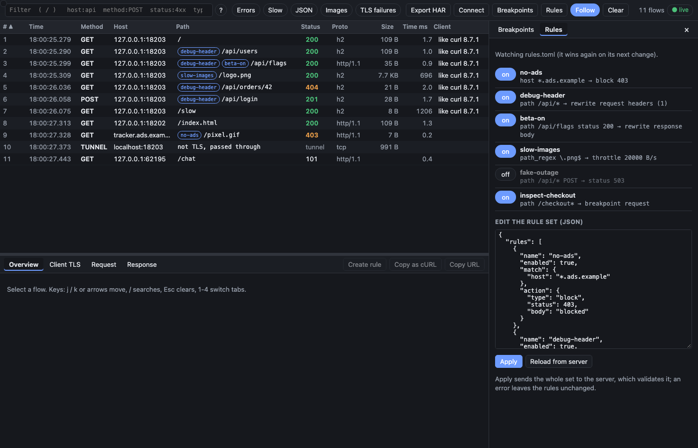

# wirust

A free HTTPS debugging proxy in one binary: capture, inspect, change and replay HTTP traffic.
It labels every TLS connection with the client's JA4, JA3 and the known client they match.

[](https://github.com/dec0iiyy/wirust/actions/workflows/ci.yml)
[](https://github.com/dec0iiyy/wirust/releases)
[](LICENSE)


<details>
<summary>More screenshots: rules panel, WebSocket messages</summary>




</details>

## What makes it different

- **It names the TLS client.** Each TLS connection gets the client's JA4, JA3 and the known
  client they match (`curl 8.7.1`, `Chrome 131`), read from the ClientHello, also for hosts
  relayed without decrypting ([docs/passthrough.md](docs/passthrough.md)). You see which TLS
  stack an app uses, whatever its User-Agent says. QUIC connections in the WireGuard mode are
  the exception: they have no fingerprint. The official pages of Proxyman, Charles and
  mitmproxy we read do not mention JA3 or JA4.
- **No paid tier.** Map local, map remote, rewriting, breakpoints, scripts, HAR import and
  export, protobuf views and the MCP server are all in the GPL-3.0 binary. Proxyman's pricing
  page lists map local, map remote, breakpoints, scripting, protobuf, HAR and MCP as not in
  its trial. No account, no telemetry.
- **One binary, UI inside.** The web UI is compiled into the executable:
  `wirust --ui 127.0.0.1:8081` is the whole setup. Linux, macOS and Windows.
- **Bounded memory.** `--max-memory` (512 MiB by default) caps the flow data held; the oldest
  finished flows go first. Bodies are streamed, and at most `--body-limit` (1 MiB by default)
  of each is kept ([docs/options.md](docs/options.md)).
- **An MCP server that is read-only by default.** `wirust mcp` gives AI agents 11 read tools
  with secrets redacted and captured traffic marked as untrusted data. The 4 write tools
  (replay, compose, create or toggle a rule) need `--allow-write`
  ([docs/mcp.md](docs/mcp.md)). MCP itself is not unique: Proxyman has it in its paid tiers.
- **Sandboxed scripts.** [Rhai](https://rhai.rs) hooks `on_request` and `on_response` with no
  file, network or process access, 250 ms and 1,000,000 operations per call; a failing script
  fails open ([docs/scripting.md](docs/scripting.md)). Scripts and rules reload when their
  file changes.
- **gRPC without schemas.** gRPC, gRPC-Web and bare protobuf bodies are decoded without a
  `.proto` file; `--proto` adds field names ([docs/grpc.md](docs/grpc.md)).
- **Phones in one command.** `wirust connect` prints a QR code and asks before each device may
  use the proxy; `wirust android setup` configures a device or emulator over adb. An
  experimental WireGuard mode captures apps that ignore the proxy, and HTTP/3 on the client
  side ([docs/wireguard.md](docs/wireguard.md)).

Status: 0.6.0. Tried on an Android emulator, not on real phones or iOS; see [Status](#status).

## Install

Linux (x86_64, aarch64) and macOS (arm64, x86_64):

```sh
curl -fsSL https://github.com/dec0iiyy/wirust/releases/latest/download/install.sh | sh
```

The script checks the download against `SHA256SUMS` (and its build attestation when `gh` is
installed). Or take a binary from [Releases](https://github.com/dec0iiyy/wirust/releases), or
build it: `cargo build --release` (Rust 1.88+, a C compiler; `--no-default-features` leaves
out the experimental WireGuard mode).

Windows, with [Scoop](https://scoop.sh):

```powershell
scoop install https://raw.githubusercontent.com/dec0iiyy/wirust/main/packaging/scoop/wirust.json
```

The Windows binary is not code-signed, so SmartScreen may warn on first start: choose "More
info", then "Run anyway". A winget manifest is prepared in [packaging/winget](packaging/winget)
but is not in the winget repository yet. Checking hashes and attestations:
[docs/install.md](docs/install.md).

## Quick start

```sh
wirust --ui 127.0.0.1:8081     # proxy on 127.0.0.1:8080, web UI on 8081: open the link it prints
wirust ca install              # macOS, Windows: trust its certificate for your user only (asks first); Linux: prints the commands
curl -x http://127.0.0.1:8080 --cacert "$(wirust ca path)" https://example.com/
```

For browsers, `wirust --system-proxy` points the system proxy at wirust while it runs and
puts the old settings back on exit (macOS, Windows, GNOME); or set the HTTP and HTTPS proxy
to `127.0.0.1:8080` by hand. More in [docs/desktop.md](docs/desktop.md). All options and
commands: [docs/options.md](docs/options.md).

## What it does

**Capture**
- HTTP/1.1 and HTTP/2 through CONNECT, and plain `http://`. Server certificates are checked
  against the Mozilla roots.
- TLS passthrough for chosen hosts (`--passthrough`, `--decrypt-only`), with the client's
  fingerprint still recorded.
- Chaining to an HTTP or SOCKS5 proxy (`--upstream-proxy`).
- HTTP/3 only in the experimental WireGuard mode, on the client side; see
  [Connect a phone](#connect-a-phone).

**Inspect**
- A live flow list with search (`host:` `method:` `status:5xx` `type:json` `ws:`) and detail
  tabs: client TLS, headers, timing, bodies. Gzip, deflate, Brotli and zstd bodies are
  decoded; JSON, images and binary data have viewers.
- WebSocket messages, including compressed ones, and sending your own into a live connection.
- gRPC, gRPC-Web and protobuf views.
- Dark and light themes, keyboard navigation, a layout that works down to about 760 px.

**Change traffic**
- Rules in a TOML file, editable in the UI: block, status, map local, map remote, rewrite
  headers and bodies, delay, throttle ([docs/rules.md](docs/rules.md)).
- Breakpoints: pause a request or response, edit method, URL, status, headers and text body,
  then resume or abort.
- Rhai scripts (`--script`).

**Replay and share**
- Replay a captured request as it was or changed, or compose a new one.
- Copy as cURL, Python, fetch, OkHttp, URLSession, HTTPie or PowerShell.
- Export HAR 1.2, import HAR from browser dev tools, keep sessions as JSON Lines.
- A local HTTP API behind the same token as the UI.

Guides for each: [docs/README.md](docs/README.md).

## Connect a phone

```sh
wirust connect               # Wi-Fi: listens on the LAN address, prints a QR code of the setup page
wirust android setup         # USB or emulator: adb reverse, sets the device proxy, copies the CA
wirust --android-cleanup     # then run the proxy; on exit it clears the device proxy
```

The setup page offers the CA as `.crt`, `.pem` and an iOS profile. Limits, from the platforms'
documentation:

- Android trusts a user-installed CA only in browsers such as Chrome, in apps that target API
  23 or lower, and in debug builds that opt in with `debug-overrides`.
- iOS needs full trust turned on by hand for the CA; the profile is unsigned.
- Apps that pin certificates fail the handshake (`TLS-FAIL`).
- In the HTTP proxy mode (the default), apps that ignore the system proxy (Flutter's
  `dart:io`, raw sockets) and HTTP/3 never reach wirust. The WireGuard mode below is the
  exception.
- Tried on an Android emulator only; not on a real phone and not on iOS. Details:
  [docs/mobile.md](docs/mobile.md).

### WireGuard mode and HTTP/3 (experimental)

```sh
wirust wireguard add-peer phone      # prints a configuration for the WireGuard app, as text and QR code
wirust wireguard --listen 192.168.1.5:51820 --allow-remote --ui 127.0.0.1:8081
```

The phone runs the official WireGuard app pointed at this computer, so all of its traffic
reaches wirust, which terminates TCP and QUIC in userspace: no TUN device, no root.

- QUIC to UDP port 443 is served as HTTP/3. The flow shows `h3` on the client side and goes
  through the same rules, breakpoints and scripts as any other request (tested with a
  map-remote rule). The server side is HTTP/2 or HTTP/1.1 over TCP.
- QUIC to a passthrough host, to a host outside `--decrypt-only` or without SNI is refused at
  the handshake, so the client is expected to retry over TCP.
- Not built: HTTP/3 to the server, JA4 and JA3 for QUIC clients (the fields are empty), IPv6
  in the tunnel, QUIC on ports other than 443.
- Tested inside the test process only. No real browser, phone or WireGuard app has been tried,
  and HTTP/3 works only for clients that accept the wirust CA for QUIC.

Everything else: [docs/wireguard.md](docs/wireguard.md).

## Compared with

Facts about the other tools come from their official sites and documentation, read in
November 2026. A blank cell means the pages we read do not say; it does not mean the feature
is missing.

| | wirust | Proxyman | Charles | mitmproxy |
|---|---|---|---|---|
| Client JA4, JA3 and client name | yes, per TLS connection (not for QUIC) | | | |
| Price, licence | free, GPL-3.0-only | paid, one-time licence; limited trial | paid; 30-day trial | free, MIT |
| Map local, map remote | yes | paid; not in the trial | yes | yes |
| Breakpoints | yes | paid; not in the trial | yes | yes (intercept) |
| Scripting | Rhai, sandboxed | JavaScript; paid, not in the trial | | Python |
| Protobuf and gRPC views | yes, with or without `.proto` files | protobuf; paid, not in the trial | | protobuf |
| HAR import and export | yes | paid; not in the trial | | |
| MCP server for AI agents | yes; read-only by default, secrets redacted | yes, in the macOS app; paid, not in the trial; secrets redacted | | |
| WebSocket | yes, over HTTP/1.1 | paid; not in the trial | yes | yes |
| Sets the system proxy | yes: macOS, Windows, GNOME (tried on macOS only) | | yes: Windows, macOS | |
| HTTP/3 | experimental: client side only, in the WireGuard mode | | | yes: reverse proxy, local and WireGuard modes |
| Interface | web UI in a browser, CLI; no native app | native macOS app; Windows and Linux apps | desktop app: Windows, macOS, Linux | console UI, web UI (beta), command line, Python API |

Where the others are ahead: mitmproxy supports HTTP/3 in three of its modes, Proxyman and
Charles are desktop apps, and wirust's UI is a page in your browser. Not in wirust yet: a
native app, HTTP/3 to the server and in the proxy mode, a terminal UI, a SOCKS5 listener,
WebSocket over HTTP/2. See [docs/roadmap.md](docs/roadmap.md).

## Security

- The proxy listens on 127.0.0.1. Any other address needs `--allow-remote`: then anyone who
  can reach the port can use it, so wirust warns.
- The web UI and API are off unless you pass `--ui`. They need the random token in the
  printed link, accept only their own `Host` and `Origin` (no DNS rebinding, no cross-site
  requests), and the proxy refuses to forward to them.
- `wirust connect` listens on the LAN only while it runs and lets a device in only after you
  approve its IP address. A device that uses the proxy over the network cannot reach services
  on this computer's own loopback address through it (a `map_remote` rule you wrote can).
- `wirust wireguard` answers only the public keys of the peers you added and also needs
  `--allow-remote` off loopback.
- The CA key (`ca-key.pem`, mode 0600 on Unix) can sign a certificate for any site. Keep the
  config directory private and remove the CA from your trust stores when you stop using wirust.
- Flows in memory, session files (mode 0600) and HAR exports contain the traffic's passwords,
  cookies and tokens. `--upstream-insecure` turns off server certificate checks and warns on
  every start.

Report vulnerabilities privately: [SECURITY.md](SECURITY.md).

## Documentation

[docs/README.md](docs/README.md) lists every document: install, options, desktop setup, the
UI, rules, scripting, HAR and search, replay, passthrough, upstream proxies, WebSocket, gRPC,
the MCP server, phones, WireGuard capture, architecture, design, roadmap and releasing.
[CONTRIBUTING.md](CONTRIBUTING.md) covers building, testing and where code goes.

## Status

Version 0.6.0. 402 automated tests (unit and integration, offline, on loopback) run in CI on
Linux, macOS and Windows, plus a build check against Rust 1.88. They include the WireGuard and
HTTP/3 tests, which run a WireGuard client and a QUIC client inside the test process.

Measured on loopback on a laptop (debug numbers will differ): about 50,000 HTTPS requests per
second through the proxy at 16 connections, 1 GiB bodies stream at roughly 500 MB/s without
being buffered, memory is bounded by `--max-memory` (512 MiB by default), and an idle proxy
uses no CPU.

Checked by hand:
- The web UI in headless Chrome: `scripts/ui-e2e.mjs` clicks through it over the DevTools
  protocol (not in CI).
- Chrome on an Android 16 emulator over `adb`: setup, installing the CA, decrypted HTTPS,
  reset on exit.
- `--system-proxy` on macOS.

Not tried yet: real phones, anything on iOS, the WireGuard mode and HTTP/3 with a real phone,
browser or WireGuard app, `system-proxy` on Windows and GNOME, `ca install` on any real
system, Windows outside CI. The WireGuard mode has not been measured under load.

## Licence

GPL-3.0-only; see [LICENSE](LICENSE), [NOTICE](NOTICE) and
[THIRD-PARTY-LICENSES.md](THIRD-PARTY-LICENSES.md). The TLS fingerprints come from the
`fingerprint` crate of [mirrust](https://github.com/dec0iiyy/mirrust).
